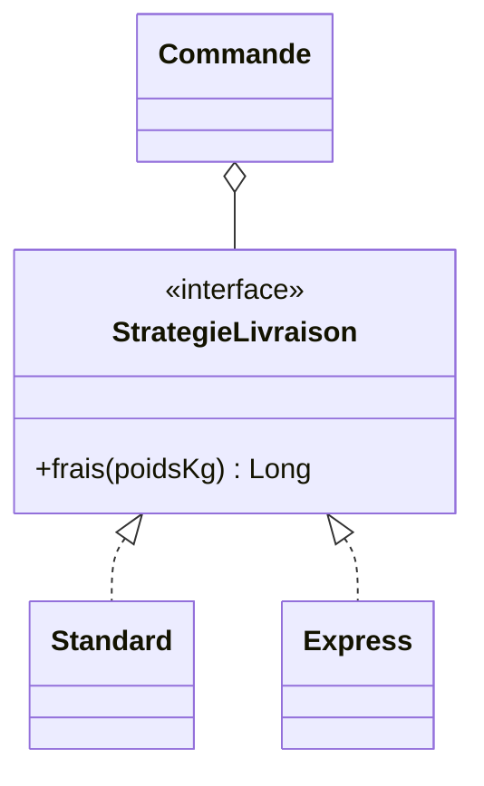

# Strategy

**Problème :** une classe doit appliquer *plusieurs variantes d'un même
algorithme* (frais de port, tri, compression…), et on veut pouvoir en ajouter
sans la modifier.

**Symptôme typique :** un `when` ou une chaîne de `if` qui grossit à chaque
nouvelle variante.

```kotlin
fun fraisDePort(mode: String, poidsKg: Int): Long = when (mode) {
    "standard" -> 499
    "express" -> 999 + 50L * poidsKg
    "retrait" -> 0
    else -> error("Mode inconnu : $mode")
}
```

**Solution :** chaque variante devient un objet qui implémente une interface
commune. Le code client reçoit une stratégie et l'utilise sans connaître sa
classe concrète.

```kotlin
fun interface StrategieLivraison {
    fun frais(poidsKg: Int): Long // en centimes
}

object Standard : StrategieLivraison {
    override fun frais(poidsKg: Int): Long = 499
}

object Express : StrategieLivraison {
    override fun frais(poidsKg: Int): Long = 999 + 50L * poidsKg
}

class Commande(private val livraison: StrategieLivraison) {
    fun total(prixArticles: Long, poidsKg: Int): Long =
        prixArticles + livraison.frais(poidsKg)
}

// Nouvelle variante = nouveau code, sans toucher à Commande
val retrait = StrategieLivraison { 0 }
```



## Ce que ça apporte

- **Ouvert/fermé** (le O de SOLID) : on ajoute une variante sans modifier le code existant.
- **Testabilité** : on teste chaque stratégie seule, et `Commande` avec une fausse stratégie.
- **Choix à l'exécution** : la stratégie peut venir d'une configuration ou d'un choix de l'utilisateur.

## Quand ne pas l'utiliser

Deux variantes stables qui ne bougeront jamais : un simple `if` est plus lisible.
En Kotlin, passer une fonction `(Int) -> Long` en paramètre suffit souvent :
c'est Strategy, sans la cérémonie.

## Dans DevForge

Chaque type d'exercice a son évaluateur (`QcmEvaluator`, `ParsonsEvaluator`…)
derrière la même interface `Evaluator`. Ajouter un type d'exercice ne touche pas
au code des autres.
