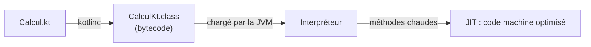

# Du Kotlin au bytecode

Ton code Kotlin ne s'exécute jamais tel quel. Il passe par trois étapes :



1. **Compilation** : `kotlinc` (ou `javac` pour Java) produit des fichiers `.class` contenant
   du **bytecode**, un jeu d'instructions indépendant du processeur.
2. **Interprétation** : au démarrage, la JVM exécute ce bytecode instruction par instruction.
3. **Compilation à la volée (JIT)** : les méthodes appelées souvent sont compilées en code
   machine optimisé. C'est pourquoi un programme JVM est plus lent au démarrage, puis
   accélère : le **temps de chauffe** (*warm-up*).

C'est ce qui permet à Kotlin, Java, Scala ou Clojure de tourner sur la même JVM :
ils parlent tous bytecode.

## Une machine à pile

La JVM ne travaille pas avec des registres comme un processeur, mais avec une **pile
d'opérandes** : les instructions dépilent leurs arguments et empilent leur résultat.

```kotlin
fun somme(a: Int, b: Int): Int = a + b
```

Le bytecode réel, obtenu avec `javap -c` :

```
public static final int somme(int, int);
  Code:
     0: iload_0      // empile la variable locale 0 (a)
     1: iload_1      // empile la variable locale 1 (b)
     2: iadd         // dépile deux int, empile leur somme
     3: ireturn      // renvoie le sommet de la pile
```

Chaque frame contient un tableau de **variables locales** (ici `a` en 0, `b` en 1)
et une **pile d'opérandes**. Le préfixe indique le type : `i` pour `int`, `l` pour
`long`, `d` pour `double`, `a` pour une référence.

## Une boucle, vue de l'intérieur

```kotlin
fun boucle(n: Int): Int {
    var total = 0
    for (i in 0 until n) {
        total += i
    }
    return total
}
```

```
 0: iconst_0          // total = 0
 1: istore_1
 2: iconst_0          // i = 0
 3: istore_2
 4: iload_2           // si i >= n, sauter en 19
 5: iload_0
 6: if_icmpge 19
 9: iload_1           // total = total + i
10: iload_2
11: iadd
12: istore_1
13: iinc 2, 1         // i++
16: goto 4            // recommencer
19: iload_1           // return total
20: ireturn
```

Une boucle `for`, c'est un test, un saut conditionnel et un `goto`.

## Voir le bytecode soi-même

- En ligne de commande : `javap -c -p MaClasse.class`
- Dans IntelliJ ou Android Studio : *Tools → Kotlin → Show Kotlin Bytecode*, puis *Decompile*
  pour le voir traduit en Java.

C'est le meilleur moyen de comprendre ce que Kotlin génère pour toi : les getters des
propriétés, les méthodes `component1()` des `data class`, les vérifications de nullité,
le *boxing*, les fonctions `inline`…

## À retenir

- Kotlin → bytecode → interprété → compilé par le JIT pour les méthodes chaudes.
- La JVM est une **machine à pile** : les instructions travaillent sur une pile d'opérandes.
- `javap -c` montre ce que ton code devient vraiment.
