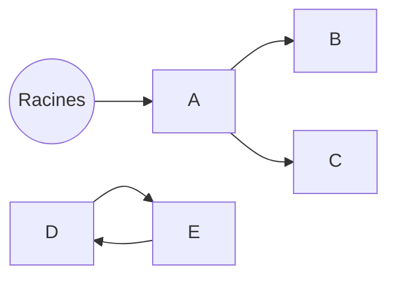

# Comment marche un ramasse-miettes

Un ramasse-miettes (*garbage collector*, GC) libère la mémoire des objets dont plus
personne ne peut se servir. Toute la question est : **comment savoir qu'un objet ne
servira plus ?**

## Racines et accessibilité

Un GC « traçant » (celui de la JVM, de Go, de .NET…) part des **racines** :

- les variables locales et paramètres des frames de **toutes les piles** ;
- les champs **statiques** (`object`, `companion object`) ;
- les threads actifs, les références tenues par du code natif.

Il suit toutes les références depuis ces racines. Tout objet atteint est **vivant**.
Tout le reste est mort et peut être libéré, **même s'il est référencé par d'autres
objets morts**.

Ici A, B et C sont vivants. D et E se référencent mutuellement, mais aucune racine ne
les atteint : ils seront collectés.

## Et le comptage de références ?

Autre approche (Swift, Python, `shared_ptr` en C++) : chaque objet compte combien de
références pointent vers lui, et il est libéré quand le compteur tombe à zéro.
C'est immédiat et prévisible, mais **les cycles fuient** : D et E garderaient chacun
un compteur à 1 pour toujours. D'où les références faibles en Swift, et le détecteur de
cycles en Python.

## Les algorithmes de base

| Algorithme | Principe | Point fort | Point faible |
|---|---|---|---|
| **Marquer-balayer** | marque les vivants, libère le reste sur place | simple | fragmente la mémoire |
| **Marquer-compacter** | marque, puis fait glisser les survivants | plus de trous | déplacer coûte cher |
| **Copie** | recopie les survivants dans un autre espace | coût proportionnel aux **vivants**, pas aux morts | nécessite deux fois l'espace |

## L'hypothèse générationnelle

Observation faite sur presque tous les programmes : **la plupart des objets meurent
jeunes** (variables temporaires, chaînes intermédiaires, itérateurs…).

D'où les GC générationnels :

- une **jeune génération**, petite, collectée **souvent** par copie : presque tout y est
  mort, donc c'est très rapide ;
- une **vieille génération**, grande, où sont promus les survivants, collectée **rarement**.

Pour que ça marche, le GC doit savoir quand un vieil objet se met à pointer vers un
jeune : c'est le rôle des **barrières d'écriture**, un petit code ajouté à chaque
affectation de référence.

## Les pauses

Pendant certaines phases, le GC doit arrêter tous les threads de l'application :
c'est une pause **stop-the-world**. Les collecteurs modernes (G1, ZGC, Shenandoah)
font l'essentiel du travail **en même temps** que l'application, au prix de
barrières plus coûteuses.

Un GC arbitre toujours entre trois objectifs :

- **le débit** : la part du temps CPU laissée à l'application ;
- **la latence** : la durée des pauses ;
- **l'empreinte** : la mémoire supplémentaire nécessaire.

On ne peut pas maximiser les trois à la fois.

## À retenir

- Vivant = **accessible depuis une racine**. Rien d'autre ne compte.
- Les cycles ne posent aucun problème à un GC traçant, mais font fuir le comptage de références.
- La plupart des objets meurent jeunes : les GC générationnels en profitent.
- Choisir un GC, c'est choisir entre débit, latence et empreinte.
