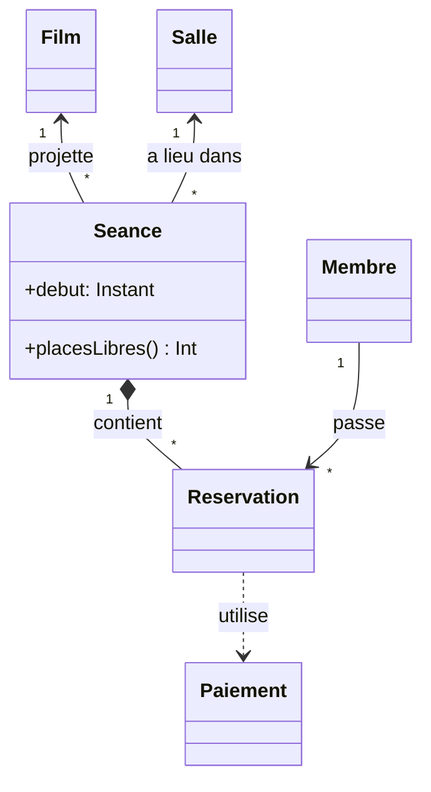

# Modéliser un domaine

## Trouver les objets

On part du **langage du métier**. Dans « un membre réserve des places pour une séance
d'un film, dans une salle », les noms donnent les candidats (Membre, Réservation, Séance,
Film, Salle), les verbes donnent les comportements (réserver, annuler, confirmer).

Deux sortes d'objets :

- les **entités** ont une identité qui dure (un membre reste le même membre même s'il
  change d'adresse) ;
- les **value objects** n'ont que des valeurs (un montant, une adresse, un créneau) : deux
  montants de 10 € sont interchangeables. Immuables, idéalement en `data class` ou `value class`.

## Les diagrammes UML utiles

On n'utilise vraiment que deux diagrammes : le diagramme de **classes** (la structure) et
le diagramme de **séquence** (une interaction dans le temps).



| Flèche | Sens |
|---|---|
| `--▷` (triangle vide) | héritage : « est une sorte de » |
| `..▷` (pointillés + triangle) | réalisation : implémente une interface |
| `◆--` (losange plein) | **composition** : la partie meurt avec le tout (une réservation n'existe pas sans sa séance) |
| `◇--` (losange vide) | **agrégation** : la partie peut vivre seule (un joueur et son équipe) |
| `-->` | association : « connaît » |
| `..>` | dépendance : « utilise ponctuellement » |

Les nombres (`1`, `*`, `0..1`) sont les **multiplicités** : une séance a lieu dans une salle,
une salle accueille plusieurs séances.

## Modèle riche ou modèle anémique ?

Un modèle **anémique** n'a que des données ; toute la logique est dans des « services » qui
modifient ses champs de l'extérieur. Un modèle **riche** porte ses règles :

```kotlin
class Seance(private val capacite: Int) {
    private val reservations = mutableListOf<Reservation>()

    fun placesLibres(): Int = capacite - reservations.sumOf { it.places }

    fun reserver(membre: Membre, places: Int): Reservation {
        require(places in 1..placesLibres()) { "plus assez de places" }
        return Reservation(membre, places).also { reservations += it }
    }
}
```

Impossible de surréserver : la règle vit **dans** la séance, pas dans dix services différents.

## Invariants et programmation par contrat

Un contrat a trois parties :

- **Préconditions** : ce que l'appelant doit garantir. En Kotlin : `require(…)`, qui lève
  `IllegalArgumentException`.
- **Postconditions** : ce que la méthode garantit en retour.
- **Invariants** : ce qui est toujours vrai pour un objet valide. On les vérifie avec
  `check(…)`, qui lève `IllegalStateException`.

```kotlin
class Reservation(val places: Int, private val capacite: Int) {
    var confirmee = false
        private set

    init { require(places in 1..capacite) { "places hors limites : $places" } }

    fun confirmer() {
        check(!confirmee) { "déjà confirmée" }
        confirmee = true
    }
}
```

Sorties réelles : `Reservation(0, 10)` lève
`IllegalArgumentException: places hors limites : 0` ; confirmer deux fois lève
`IllegalStateException: déjà confirmée`. Un objet invalide ne peut jamais exister.

## Liskov en profondeur

Une sous-classe respecte le contrat de son parent si :

1. elle n'exige **pas plus** (préconditions identiques ou plus souples) ;
2. elle ne promet **pas moins** (postconditions identiques ou plus fortes) ;
3. elle préserve les **invariants** du parent ;
4. elle ne lève pas de nouvelles exceptions inattendues.

Contre-exemple réel, dans la bibliothèque standard :

```kotlin
fun ajouterZero(liste: MutableList<Int>) {
    liste.add(0)
}

val lecture = listOf(1, 2)
ajouterZero(lecture as MutableList<Int>)   // UnsupportedOperationException
```

L'objet se présente comme une `MutableList` (le cast passe), mais refuse `add` : il exige
plus que le contrat. Kotlin limite le problème en séparant `List` (lecture) et
`MutableList` (écriture) **dans les types** : c'est le principe de ségrégation des interfaces
au service de Liskov.

## À retenir

- Les noms du métier donnent les objets ; entités (identité) et value objects (valeurs immuables).
- UML utile : classes et séquences ; composition (◆) ou agrégation (◇).
- Modèle riche : les règles vivent dans les objets.
- `require` pour les préconditions, `check` pour l'état ; un objet invalide ne doit pas exister.
- Liskov : ne pas exiger plus, ne pas promettre moins.
