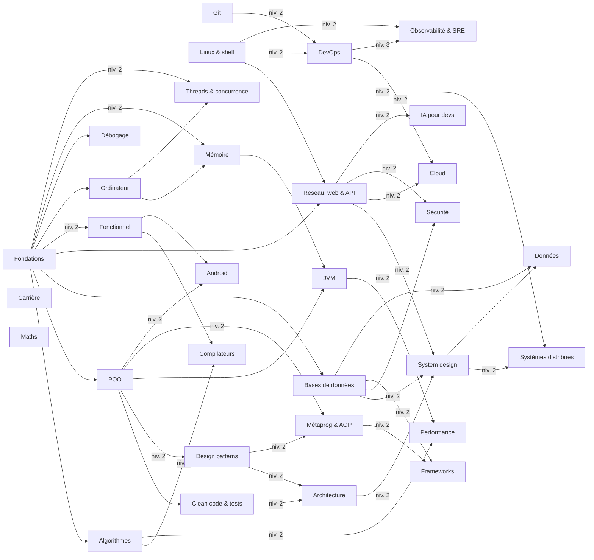

# 02 — Curriculum

Le curriculum est la colonne vertébrale de DevForge. Sa version « machine » est
[`content/curriculum.yaml`](../content/curriculum.yaml) (parcours et prérequis) et
les `track.yaml` de chaque parcours (compétences par niveau).

## Les 5 rangs

Inspirés du compagnonnage et de la taxonomie de Bloom : chaque rang demande un
niveau de réflexion plus élevé, et les types d'exercices suivent.

| Rang | Verbe | Tu sais… | Exercices typiques |
|---|---|---|---|
| 1. Novice | découvrir | reconnaître et définir les concepts | QCM, prédire la sortie, relier |
| 2. Apprenti | appliquer | utiliser les concepts sur des cas guidés | Parsons, trous, trouver le bug |
| 3. Compagnon | analyser | choisir la bonne solution, la justifier, détecter les problèmes | revue de code, scénarios, code |
| 4. Expert | concevoir | concevoir une solution complète et arbitrer des compromis | system design, projets |
| 5. Maître | transmettre | maîtriser les cas limites, enseigner, innover | explications, projets avancés |

## Carte des parcours

Une flèche signifie « débloque ». Sans étiquette : il faut le niveau 1 du parcours
de départ ; sinon, le niveau indiqué.

`Maths`, `Git`, `Linux` et `Carrière` n'ont aucun prérequis : on peut les commencer dès le premier jour.

## Les 31 parcours

Légende : ⭐ = parcours pilote, dont les compétences sont détaillées dans un `track.yaml`
et qui contient déjà des leçons ou des exercices.

Ce qui distingue un débutant d'un expert dans chaque domaine est détaillé dans
[06 — Du novice à l'expert](06-novice-vers-expert.md).

### Fondations de la programmation — `fondations`

| Niv. | Contenu |
|---|---|
| 1 | variables, types, opérateurs, conditions, boucles, fonctions |
| 2 | collections (listes, maps, ensembles), chaînes, portée, récursivité, exceptions |
| 3 | mémoire (pile, tas, références, ramasse-miettes), complexité Big-O, nullabilité, typage statique/dynamique |
| 4 | génériques et variance, compilation vs interprétation, JVM et bytecode, modules et packaging |
| 5 | apprendre un langage en une semaine : Kotlin, Python, Go, Rust (ownership), TypeScript ; les paradigmes |

### Git et collaboration — `git`

| Niv. | Contenu |
|---|---|
| 1 | init, add, commit, log, diff, `.gitignore` |
| 2 | branches, merge, conflits, remotes, push/pull, pull requests |
| 3 | rebase, cherry-pick, stash, reflog, bisect |
| 4 | workflows (trunk-based, GitHub Flow, GitFlow), Conventional Commits, SemVer, hooks, monorepos |
| 5 | internes (blobs, trees, commits, refs), stratégies de merge, très gros dépôts |

### Linux et shell — `linux`

| Niv. | Contenu |
|---|---|
| 1 | arborescence, fichiers, permissions, pipes, redirections |
| 2 | processus, signaux, variables d'environnement, grep/sed/awk/find, scripts bash |
| 3 | systemd, journaux, réseau (`ss`, `curl`, `dig`), SSH et clés, cron, paquets |
| 4 | diagnostic de performance (`top`, `vmstat`, `iostat`, `strace`, `lsof`), systèmes de fichiers, cgroups et namespaces |
| 5 | appels système, ordonnanceur, durcissement, eBPF (aperçu) |

### Algorithmes et structures de données — `algo`

| Niv. | Contenu |
|---|---|
| 1 | tableaux, chaînes, recherche linéaire et dichotomique, tris simples, Big-O |
| 2 | piles, files, listes chaînées, tables de hachage, deux pointeurs, fenêtre glissante |
| 3 | arbres (BST, parcours), tas, backtracking, tris en n log n |
| 4 | graphes (BFS, DFS, Dijkstra, tri topologique, union-find), programmation dynamique, algorithmes gloutons |
| 5 | tries, segment trees, algorithmes de chaînes, structures probabilistes (Bloom filter, HyperLogLog), analyse amortie |

### ⭐ Programmation orientée objet — `poo`

| Niv. | Contenu |
|---|---|
| 1 | classes et objets, constructeurs, propriétés et méthodes, encapsulation, égalité et identité |
| 2 | héritage, polymorphisme, classes abstraites, interfaces, surcharge vs redéfinition, contrat `equals`/`hashCode` |
| 3 | composition plutôt qu'héritage, SOLID, loi de Déméter, couplage et cohésion, objets immuables et value objects |
| 4 | UML (classes, séquences), modélisation d'un domaine, invariants et programmation par contrat, Liskov en profondeur |
| 5 | traits, mixins et délégation, prototypes, quand ne **pas** utiliser la POO |

### Programmation fonctionnelle — `fonctionnel`

| Niv. | Contenu |
|---|---|
| 1 | lambdas, fonctions d'ordre supérieur, map/filter/reduce, immutabilité |
| 2 | fonctions pures, effets de bord, composition, sealed classes et pattern matching |
| 3 | Option/Result, gestion d'erreurs fonctionnelle, évaluation paresseuse, récursivité terminale |
| 4 | types algébriques, functors et monades en pratique (Arrow), effets, programmation réactive |
| 5 | structures de données persistantes, lambda-calcul, langages purs (Haskell), théorie des catégories (aperçu) |

### Clean code, refactoring et tests — `clean-code`

| Niv. | Contenu |
|---|---|
| 1 | nommage, fonctions courtes, commentaires utiles, DRY, KISS, YAGNI |
| 2 | code smells, refactorings de base (extraire, renommer, déplacer), tests unitaires, structure Arrange-Act-Assert |
| 3 | TDD, doublures de test (mock, stub, fake), pyramide des tests, tests d'intégration, couverture |
| 4 | refactoring de legacy (tests de caractérisation, *seams*), tests de contrat, property-based testing |
| 5 | mutation testing, architecture testable, stratégie de tests d'une équipe, revue de code comme pratique |

### ⭐ Design patterns — `design-patterns`

Les 23 patterns du Gang of Four sont tous couverts, répartis selon leur fréquence d'usage.

| Niv. | Contenu |
|---|---|
| 1 | pourquoi des patterns, Singleton, Factory Method, Strategy, Observer |
| 2 | Abstract Factory, Builder, Prototype, Adapter, Decorator, Facade, Proxy |
| 3 | Command, State, Template Method, Chain of Responsibility, Iterator, Mediator, Composite, Bridge, Flyweight |
| 4 | Visitor, Memento, Interpreter ; Repository et Unit of Work, injection de dépendances, Specification, Null Object ; anti-patterns |
| 5 | les patterns dans les frameworks (Spring, Android, OkHttp), patterns d'intégration, résilience (Circuit Breaker, Retry, Bulkhead), éviter la sur-ingénierie |

### Bases de données — `bdd`

| Niv. | Contenu |
|---|---|
| 1 | tables, SELECT/INSERT/UPDATE/DELETE, WHERE, ORDER BY, clés primaires |
| 2 | jointures, GROUP BY, sous-requêtes, clés étrangères, modélisation, normalisation (1NF → 3NF) |
| 3 | index, plans d'exécution (`EXPLAIN`), transactions ACID, niveaux d'isolation, ORM et problème N+1 |
| 4 | NoSQL (document, clé-valeur, colonnes, graphe), réplication, partitionnement, migrations sans interruption |
| 5 | internes (MVCC, WAL, LSM-trees), bases distribuées, choisir son stockage |

### Réseau, web et API — `reseau-web`

| Niv. | Contenu |
|---|---|
| 1 | client/serveur, HTTP (méthodes, codes, en-têtes), URL, DNS, JSON |
| 2 | REST (ressources, idempotence, pagination, versions), cookies, sessions, CORS |
| 3 | TCP/IP, TLS, HTTP/2 et HTTP/3, OAuth2, OpenID Connect, JWT, WebSockets |
| 4 | gRPC, GraphQL, conception d'API (OpenAPI, rétrocompatibilité), rate limiting, API gateway |
| 5 | performance réseau, proxys et load balancers L4/L7, CDN, edge computing |

### ⭐ Architecture logicielle — `architecture`

| Niv. | Contenu |
|---|---|
| 1 | architecture en couches, séparation des responsabilités, MVC |
| 2 | MVVM et MVI, injection de dépendances à l'échelle d'une app, modularisation, cohésion et couplage des modules |
| 3 | architecture hexagonale, Clean Architecture, DDD tactique (entités, value objects, agrégats, événements de domaine) |
| 4 | DDD stratégique (bounded contexts), CQRS, event sourcing, monolithe modulaire ou microservices, ADR |
| 5 | architecture évolutive (fitness functions), migration de legacy (strangler fig), loi de Conway, Team Topologies |

### ⭐ System design — `system-design`

| Niv. | Contenu |
|---|---|
| 1 | latence, débit, disponibilité, scalabilité verticale/horizontale, estimations à la louche |
| 2 | répartition de charge, cache, CDN, réplication, services sans état |
| 3 | files de messages, idempotence, partitionnement, théorème CAP, cohérence éventuelle |
| 4 | études de cas : raccourcisseur d'URL, fil d'actualité, messagerie, rate limiter, notifications |
| 5 | consensus (Raft), horloges et ordre des événements, sagas, multi-région |

### ⭐ DevOps, conteneurs et CI/CD — `devops`

| Niv. | Contenu |
|---|---|
| 1 | culture DevOps, environnements (dev, staging, prod), les 12 facteurs |
| 2 | images et Dockerfile, couches et cache, images sûres (non-root, secrets, taille), Docker Compose |
| 3 | intégration continue, déploiement continu et artefacts, rolling / blue-green / canary, feature flags |
| 4 | Terraform, Ansible, Kubernetes, diagnostic dans Kubernetes, Helm |
| 5 | GitOps (Argo CD), platform engineering, sécurité de la chaîne logicielle (SBOM, signature) |

### Cloud — `cloud`

| Niv. | Contenu |
|---|---|
| 1 | IaaS, PaaS, SaaS, régions et zones, responsabilité partagée |
| 2 | calcul (VM, conteneurs managés, serverless), stockage (objet, bloc, fichier), bases managées |
| 3 | réseau cloud (VPC, sous-réseaux, groupes de sécurité, NAT), IAM et moindre privilège |
| 4 | architectures de référence, haute disponibilité, reprise après sinistre (RPO, RTO), FinOps |
| 5 | multi-cloud, landing zones, gouvernance, frameworks *well-architected* |

### Observabilité et SRE — `sre`

| Niv. | Contenu |
|---|---|
| 1 | logs, métriques, traces : à quoi ils servent ; monitoring vs observabilité |
| 2 | logs structurés, Prometheus (counter, gauge, histogram), tableaux de bord Grafana, alertes |
| 3 | traces distribuées (OpenTelemetry), méthodes RED et USE, SLI, SLO, SLA, budgets d'erreur |
| 4 | gestion d'incident (rôles, communication), post-mortems sans blâme, capacity planning, tests de charge |
| 5 | chaos engineering, fiabilité à grande échelle, réduction du travail répétitif (toil) |

### Sécurité — `securite`

| Niv. | Contenu |
|---|---|
| 1 | confidentialité, intégrité, disponibilité ; mots de passe ; hachage vs chiffrement ; HTTPS |
| 2 | OWASP Top 10 : injections, XSS, CSRF, contrôle d'accès défaillant ; validation des entrées |
| 3 | authentification et autorisation, gestion des secrets, cryptographie appliquée (AES, RSA, signatures) |
| 4 | modélisation des menaces (STRIDE), sécurité des conteneurs et de Kubernetes, chaîne logicielle, SAST/DAST/SCA |
| 5 | sécurité dès la conception, réponse à incident de sécurité, bases du pentest éthique, RGPD |

### Maths pour l'informatique — `maths`

| Niv. | Contenu |
|---|---|
| 1 | logique booléenne, bases numériques (binaire, hexadécimal), puissances de 2, arithmétique modulaire |
| 2 | ensembles, relations, fonctions, récurrence et preuves simples, combinatoire |
| 3 | probabilités, statistiques (moyenne, médiane, percentiles, écart-type), lois à longue traîne |
| 4 | graphes, notation asymptotique, nombres flottants (IEEE 754), algèbre linéaire de base |
| 5 | théorie de l'information (entropie), calculabilité (problème de l'arrêt), maths de la cryptographie |

### Comment fonctionne un ordinateur — `ordinateur`

| Niv. | Contenu |
|---|---|
| 1 | binaire, octets, processeur, mémoire vive, stockage, du code source à l'exécution |
| 2 | jeu d'instructions, registres, cycle d'exécution, lire quelques lignes d'assembleur |
| 3 | système d'exploitation : processus, threads, ordonnancement, appels système, interruptions |
| 4 | mémoire virtuelle, pagination, hiérarchie des caches, entrées-sorties (bloquantes, non bloquantes, epoll) |
| 5 | pipeline, exécution spéculative, prédiction de branchement, SIMD, NUMA, *mechanical sympathy* |

### ⭐ Gestion de la mémoire — `memoire`

| Niv. | Contenu |
|---|---|
| 1 | pile et tas, valeurs et références, portée et durée de vie, taille et représentation des données |
| 2 | malloc et free, bugs mémoire (fuites, use-after-free, double libération, débordements), RAII, comptage de références et cycles, possession et emprunt (Rust) |
| 3 | racines et accessibilité, marquer-balayer-compacter, GC par copie, hypothèse générationnelle, pauses et GC concurrent |
| 4 | fuites malgré le GC, références faibles, douces et fantômes, heap dumps, mémoire hors tas |
| 5 | allocateurs (arènes, pools), fragmentation, caches du processeur et localité, faux partage, disposition des objets |

### ⭐ La JVM de l'intérieur — `jvm`

| Niv. | Contenu |
|---|---|
| 1 | bytecode et machine à pile, zones mémoire (tas, piles, metaspace, code cache), primitifs, boxing et cache des Integer |
| 2 | chargement des classes, ordre d'initialisation, interpréteur et JIT, exceptions et piles d'appels |
| 3 | collecteurs (Serial, Parallel, G1, ZGC, Shenandoah), G1 en détail, logs du GC, choisir et régler son GC |
| 4 | options de la JVM, jcmd/jstack/jmap/jstat, Java Flight Recorder, inlining et escape analysis, la JVM en conteneur |
| 5 | GraalVM et compilation native, JNI et Foreign Function & Memory, spécification de la JVM, langages de la JVM |

### ⭐ Threads et concurrence — `concurrence`

| Niv. | Contenu |
|---|---|
| 1 | concurrence et parallélisme, processus et threads, créer et attendre des threads, conditions de course |
| 2 | synchronized, visibilité et volatile, variables atomiques, interblocages, collections concurrentes |
| 3 | modèle mémoire Java (happens-before), pools de threads, CompletableFuture, verrous avancés, ThreadLocal |
| 4 | coroutines Kotlin, concurrence structurée et annulation, threads virtuels, flux réactifs et backpressure |
| 5 | algorithmes sans verrou (CAS, ABA), barrières mémoire, modèle d'acteurs, tester du code concurrent, concevoir pour la concurrence |

### ⭐ Métaprogrammation et AOP — `metaprog`

| Niv. | Contenu |
|---|---|
| 1 | annotations, réflexion, KClass et réflexion Kotlin |
| 2 | préoccupations transverses, proxies dynamiques, délégation Kotlin |
| 3 | AOP (aspect, point de jonction, coupe, greffon), tissage, Spring AOP et ses pièges, `@Transactional` sous le capot |
| 4 | ASM et ByteBuddy, agents Java, génération de code (KSP), plugins du compilateur |
| 5 | DSL Kotlin, macros, quand la magie coûte trop cher |

### Les frameworks de l'intérieur — `frameworks`

| Niv. | Contenu |
|---|---|
| 1 | inversion de contrôle, bibliothèque ou framework, cycle de vie d'une requête web |
| 2 | conteneur d'injection de dépendances : beans, portées, cycle de vie, auto-configuration (Spring Boot) |
| 3 | JPA/Hibernate : contexte de persistance, dirty checking, chargement paresseux, transactions |
| 4 | serveurs web (servlets, Netty, boucle d'événements), Ktor et ses plugins, frameworks réactifs |
| 5 | lire le code source d'un framework ; écrire ton propre mini-framework (injection + routage) |

### Langages et compilateurs — `compilation`

| Niv. | Contenu |
|---|---|
| 1 | interprété ou compilé, étapes d'un compilateur, grammaires |
| 2 | analyse lexicale, analyse syntaxique (descente récursive), arbre syntaxique (AST) |
| 3 | interpréteur d'AST, portée et environnements, fermetures |
| 4 | systèmes de types, inférence de types, génération de bytecode |
| 5 | optimisations (propagation de constantes, code mort), SSA, LLVM ; projet : ton propre langage |

### Performance et optimisation — `performance`

| Niv. | Contenu |
|---|---|
| 1 | mesurer avant d'optimiser, latence et débit, percentiles (p50, p99) |
| 2 | microbenchmarks (JMH) et leurs pièges, profilers, flame graphs |
| 3 | complexité en pratique, allocations et pression sur le GC, caches applicatifs, entrées-sorties |
| 4 | performance des bases de données, tests de charge, loi de Little, loi d'Amdahl |
| 5 | *mechanical sympathy*, optimisations du JIT, structures adaptées au cache, latence de queue |

### Débogage et diagnostic — `debogage`

| Niv. | Contenu |
|---|---|
| 1 | lire un message d'erreur et une stack trace, reproduire un bug, la méthode scientifique |
| 2 | débogueur (points d'arrêt, pas à pas, conditions), logs utiles |
| 3 | `git bisect`, réduire un cas de test, bugs intermittents, débogage à distance |
| 4 | thread dumps (interblocages, contention), heap dumps (fuites), profilage en production |
| 5 | déboguer un système distribué (traces, corrélation), post-mortems, déboguer le code des autres |

### Systèmes distribués — `systemes-distribues`

| Niv. | Contenu |
|---|---|
| 1 | les illusions de l'informatique distribuée, pannes partielles, latence réseau |
| 2 | temps et horloges (Lamport, horloges vectorielles), ordre des événements |
| 3 | réplication (leader, multi-leader, sans leader), quorums, modèles de cohérence |
| 4 | consensus (Raft, Paxos), élection de leader, 2PC et sagas, « exactement une fois » |
| 5 | CRDT, split-brain, vérification formelle (TLA+), articles fondateurs (Dynamo, Spanner) |

### Ingénierie des données — `donnees`

| Niv. | Contenu |
|---|---|
| 1 | formats (CSV, JSON, Parquet, Avro), ETL et ELT |
| 2 | entrepôts de données, modèle en étoile, SQL analytique (fonctions de fenêtre) |
| 3 | traitement par lots (Spark), orchestration (Airflow), qualité des données |
| 4 | streaming (Kafka, Flink), fenêtres temporelles, sémantiques de livraison, change data capture |
| 5 | lakehouse, gouvernance, évolution des schémas, coûts |

### Développement Android — `android`

| Niv. | Contenu |
|---|---|
| 1 | composants d'une app, activités, cycle de vie, ressources, manifeste |
| 2 | Jetpack Compose : composables, état, recomposition, listes |
| 3 | ViewModel, navigation, coroutines sur Android, persistance (Room, DataStore) |
| 4 | architecture en couches et en modules, WorkManager, tests, injection de dépendances |
| 5 | performance (fluidité, démarrage), accessibilité, publication et suivi en production |

### IA pour les développeurs — `ia-dev`

| Niv. | Contenu |
|---|---|
| 1 | ce qu'est un LLM (jetons, contexte, probabilités), usages, limites, hallucinations |
| 2 | appeler une API de LLM, rédiger de bons prompts, sorties structurées |
| 3 | embeddings, recherche sémantique, RAG |
| 4 | outils et agents, évaluation, coûts et latence, sécurité (injection de prompt) |
| 5 | fine-tuning et alternatives, observabilité, concevoir un produit avec l'IA |

### Carrière et collaboration — `carriere`

| Niv. | Contenu |
|---|---|
| 1 | poser une bonne question, lire une documentation, écrire un ticket clair |
| 2 | revue de code (donner et recevoir), estimation, découpage en tâches |
| 3 | documentation technique, ADR, RFC, présentations techniques |
| 4 | entretiens techniques (algo, system design, comportemental), mentorat |
| 5 | leadership technique, influence sans autorité, rôles staff et principal engineer |

## Projets fil rouge

Un projet par rang, réalisé hors de l'app, sur GitHub. Chacun réutilise le précédent.

| Rang | Projet | Ce qu'il fait travailler |
|---|---|---|
| Novice | **Gestionnaire de tâches en ligne de commande** (Kotlin), sauvegarde dans un fichier, tests unitaires | POO de base, collections, fichiers, Git |
| Apprenti | **API REST de bibliothèque** (Ktor), PostgreSQL, Docker Compose | couches, SQL, HTTP, Docker |
| Compagnon | la même API en **architecture hexagonale**, en TDD, avec CI GitHub Actions et déploiement sur une VM | patterns, tests, CI/CD, Linux |
| Expert | **système de réservation** en 2-3 services pilotés par événements, Kubernetes, Terraform, OpenTelemetry, SLO | architecture distribuée, IaC, SRE |
| Maître | **DevForge en production** : runner de code sécurisé, multi-environnements, GitOps, chaos engineering, post-mortems | tout |

### Projets d'expert

Des projets courts qui obligent à comprendre ce qui se passe sous le capot.

| Projet | Parcours |
|---|---|
| Un mini-conteneur d'injection de dépendances avec AOP par proxies | metaprog, frameworks |
| Un pool de threads et une file bloquante écrits à la main, testés sous charge | concurrence |
| Un simulateur visuel de ramasse-miettes (marquer-balayer, puis générationnel) | memoire, jvm |
| Un interpréteur pour un petit langage, puis un compilateur vers du bytecode | compilation, jvm |
| Un mini-Redis : serveur TCP, protocole, persistance, réplication | reseau-web, performance, systemes-distribues |
| Raft en Kotlin, testé avec des pannes simulées | systemes-distribues, concurrence |

## Ordre conseillé : 5 saisons

Une saison ≈ 3 mois à 8-10 heures par semaine, soit environ 15 mois pour les 5 saisons. L'ordre respecte les prérequis.

| Saison | Parcours |
|---|---|
| 1 — Les bases | fondations 1-3, maths 1-2, git 1-2, linux 1-2, ordinateur 1-2, poo 1-3, clean-code 1-2, debogage 1-2, algo 1-2 |
| 2 — Bien concevoir | design-patterns 1-3, fonctionnel 1-3, memoire 1-3, concurrence 1-2, jvm 1-2, bdd 1-3, reseau-web 1-2, clean-code 3, devops 1-2, android 1-3 |
| 3 — Sous le capot | jvm 3-4, memoire 4, concurrence 3-4, metaprog 1-3, performance 1-3, ordinateur 3-4, architecture 1-3, devops 3-4, securite 1-2, algo 3 |
| 4 — Passer à l'échelle | system-design 1-4, systemes-distribues 1-3, cloud 1-3, sre 1-3, frameworks 1-3, donnees 1-2, reseau-web 3, securite 3, ia-dev 1-3 |
| 5 — Vers la maîtrise | compilation 1-4, debogage 3-5, carriere 1-5, niveaux 4-5 de tes parcours préférés, projets d'expert |

## Volume de contenu

Ordre de grandeur pour tout le curriculum : 31 parcours × 5 niveaux × ~5 compétences
× (1 leçon + ~10 exercices) ≈ **750 leçons et 7 500 exercices**.

C'est le vrai chantier du projet. D'où les règles du [plan d'action](04-plan-d-action.md) :
rédiger d'abord les parcours de la saison en cours, utiliser des gabarits, et se
faire aider par l'IA pour les brouillons, avec relecture systématique.
