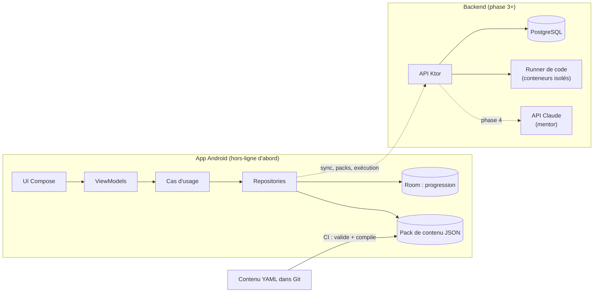
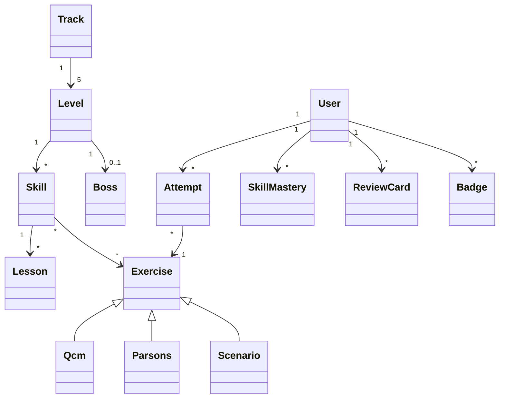

# 03 — Architecture technique

## 1. Choix de la plateforme

| Option | Points forts | Points faibles | Verdict |
|---|---|---|---|
| **Kotlin + Jetpack Compose** (Android natif) | Langage moderne, objet **et** fonctionnel. Android est un excellent terrain d'architecture (MVVM, DI, modules). Même langage pour le backend (Ktor). Ouverture vers iOS et le web avec Compose Multiplatform. | Android d'abord. | ✅ **Recommandé** |
| Flutter (Dart) | Un seul code pour Android, iOS et web. | Dart est peu utilisé hors de Flutter. | Bonne alternative |
| React Native / Expo (TypeScript) | TypeScript très demandé, proche du web. | Architecture moins structurante pour apprendre. | Possible |
| PWA (TypeScript) | Marche partout, exécution de Python dans le navigateur (Pyodide). | Expérience mobile moins native. | Plan B, ou version web plus tard |

**Décision** ([ADR 0001](adr/0001-kotlin-compose-android.md)) : Kotlin + Compose, avec un
domaine écrit en **Kotlin pur** (aucune dépendance Android) pour pouvoir passer en
Kotlin Multiplatform plus tard. Backend en Kotlin aussi : un langage maîtrisé à fond,
les autres langages arrivent par le contenu.

## 2. Vue d'ensemble



## 3. L'app Android

### Modules Gradle (implémentés)

Le projet est dans [`devforge/android/`](../android/).

```
:app                     Android + Compose : écrans, navigation, ViewModels, assemblage (AppContainer)
:core:model              entités en Kotlin pur : parcours, exercices (sealed class), progression
:core:markdown           analyseur Markdown et coloration syntaxique — Kotlin pur
:core:domain             évaluation, XP, révisions, niveaux, boss, sessions ; ports — Kotlin pur
:core:data               lecture du contenu YAML, progression en JSON — Kotlin pur (JVM)
```

Les quatre modules `core` n'ont **aucune dépendance Android** : ils sont testés sur la JVM
(38 tests), dont un test qui charge le vrai contenu du dépôt et vérifie que chaque
exercice est réussi avec sa propre solution.

Découpage prévu quand l'app grossira : `:core:designsystem`, puis un module par
fonctionnalité (`:feature:session`, `:feature:profile`…), sur le modèle de l'app exemple
officielle *Now in Android*.

**Règle de dépendance :** `feature → domain → model` et `data → domain`.
Le domaine ne connaît ni Android, ni Room, ni Compose : il se teste en JVM pur,
en quelques millisecondes.

### Modèle de données



- **Contenu** (Track, Level, Skill, Lesson, Exercise, Boss) : en lecture seule, chargé
  depuis le pack JSON.
- **Progression** (`Progress` : XP, résultats par exercice, niveaux validés, boss, série,
  cartes de révision) : un objet immuable enregistré en JSON
  ([ADR 0006](adr/0006-progression-en-json.md)), Room plus tard.

### Le moteur d'exercices

Esquisse vérifiée (elle compile et s'exécute). La version complète est dans
`core/domain/…/evaluation/Evaluation.kt` : un évaluateur par type, pour les 10 types.


```kotlin
// :core:model — le contenu, sans aucune dépendance Android
sealed interface Exercise {
    val id: String
    val difficulty: Int

    data class Qcm(
        override val id: String,
        override val difficulty: Int,
        val choices: List<Choice>,
    ) : Exercise

    data class Parsons(
        override val id: String,
        override val difficulty: Int,
        val lines: List<String>,
        val distractors: List<String>,
    ) : Exercise
}

data class Choice(val id: String, val text: String, val correct: Boolean = false)

sealed interface Answer {
    data class Choices(val ids: Set<String>) : Answer
    data class Ordering(val lines: List<String>) : Answer
}

data class Verdict(val correct: Boolean)

// :core:domain — un évaluateur par type d'exercice (Strategy)
fun interface Evaluator<E : Exercise> {
    fun evaluate(exercise: E, answer: Answer): Verdict
}

val qcmEvaluator = Evaluator<Exercise.Qcm> { exercise, answer ->
    val expected = exercise.choices.filter { it.correct }.map { it.id }.toSet()
    Verdict(answer is Answer.Choices && answer.ids == expected)
}

val parsonsEvaluator = Evaluator<Exercise.Parsons> { exercise, answer ->
    Verdict(answer is Answer.Ordering && answer.lines == exercise.lines)
}

class EvaluateAnswer(
    private val qcm: Evaluator<Exercise.Qcm> = qcmEvaluator,
    private val parsons: Evaluator<Exercise.Parsons> = parsonsEvaluator,
) {
    // `when` exhaustif sur une sealed interface : un nouveau type d'exercice
    // sans évaluateur provoque une erreur de compilation.
    operator fun invoke(exercise: Exercise, answer: Answer): Verdict = when (exercise) {
        is Exercise.Qcm -> qcm.evaluate(exercise, answer)
        is Exercise.Parsons -> parsons.evaluate(exercise, answer)
    }
}

// Machine d'état d'une session (State)
sealed interface SessionState {
    data object Loading : SessionState
    data class Answering(val exercise: Exercise, val index: Int, val total: Int) : SessionState
    data class Feedback(val exercise: Exercise, val verdict: Verdict) : SessionState
    data class Finished(val xpGained: Int, val accuracy: Double) : SessionState
}

// Règles de déblocage combinables (Specification)
interface Progress {
    fun levelOf(track: String): Int
}

fun interface UnlockRule {
    fun isSatisfiedBy(progress: Progress): Boolean
}

infix fun UnlockRule.and(other: UnlockRule) =
    UnlockRule { isSatisfiedBy(it) && other.isSatisfiedBy(it) }

fun levelReached(track: String, level: Int) =
    UnlockRule { it.levelOf(track) >= level }

// "design-patterns@2" et "clean-code@2" dans curriculum.yaml deviennent :
val unlockArchitecture = levelReached("design-patterns", 2) and levelReached("clean-code", 2)
```

### Les patterns utilisés dans l'app elle-même

Construire DevForge, c'est pratiquer le parcours *Design patterns* pour de vrai.

| Pattern | Où dans DevForge |
|---|---|
| Strategy | un évaluateur par type d'exercice ; algorithme de répétition espacée interchangeable (SM-2 puis FSRS) |
| Factory | création du bon composant Compose selon le type d'exercice |
| State | machine d'état d'une session (chargement → réponse → correction → fin) |
| Observer | `StateFlow` des ViewModels ; événements de domaine |
| Repository | accès au contenu et à la progression, indépendant de la source (JSON, Room, réseau) |
| Specification | conditions de déblocage combinables (`poo@2 et clean-code@1`) |
| Command | actions annulables dans les exercices Parsons (`ParsonsBoard`, `Move.Place` / `Move.Remove`) |
| Decorator | calcul de l'XP : base → bonus premier essai → bonus de série → malus d'indices |
| Chain of Responsibility | normalisation des réponses texte (espaces → casse → synonymes acceptés) |
| Adapter | runner de code local (faux, pour les tests) ou distant (API) derrière la même interface |
| Facade | un `GamificationService` qui cache XP, badges et séries derrière une API simple |
| Builder | construction d'une session (sélection, mélange, ajout des révisions dues) |
| Mediator / événements de domaine | `ExerciseCompleted` → XP, badges, maîtrise, répétition espacée |

### Stack de l'app

| Besoin | Choix |
|---|---|
| Langage | Kotlin 2.x |
| UI | Jetpack Compose, Material 3, Navigation Compose |
| Injection de dépendances | à la main (`AppContainer`, [ADR 0007](adr/0007-injection-manuelle.md)) ; Hilt plus tard |
| Stockage local | JSON (progression, [ADR 0006](adr/0006-progression-en-json.md)) ; Room plus tard |
| Contenu | YAML lu par snakeyaml-engine ([ADR 0005](adr/0005-lecture-du-yaml-par-l-app.md)) |
| Markdown | analyseur maison ([ADR 0004](adr/0004-rendu-markdown-maison.md)) |
| Sérialisation | kotlinx.serialization |
| Asynchrone | Coroutines et Flow |
| Tâches planifiées | WorkManager (rappel du défi du jour) — phase 2 |
| Widget | Jetpack Glance — phase 2 |
| Tests | JUnit, Turbine (Flows), fakes plutôt que mocks, tests UI Compose |
| Qualité | ktlint, detekt, Android Lint |
| Build | Gradle Kotlin DSL, version catalog, plugins de convention |

## 4. Le contenu, traité comme du code

1. **Rédaction** en YAML (exercices) et Markdown (leçons) dans `content/`, versionnés dans Git.
2. **Validation** en CI : JSON Schema + règles de cohérence (`tools/validate_content.py`).
3. **Embarqué tel quel** dans l'APK (`assets/`) et lu au démarrage
   ([ADR 0005](adr/0005-lecture-du-yaml-par-l-app.md)). Un pack JSON précompilé viendra
   quand le volume le justifiera.
4. **Phase 3** : packs téléchargeables depuis le backend, pour mettre le contenu à jour
   sans republier l'app.

Format détaillé : [05 — Format du contenu](05-format-du-contenu.md).
Décision : [ADR 0002](adr/0002-contenu-yaml-dans-git.md).

## 5. Le backend (phase 3 et suivantes)

| Besoin | Choix |
|---|---|
| API | Ktor + kotlinx.serialization |
| Base | PostgreSQL, Exposed (ou jOOQ), migrations Flyway |
| Authentification | OpenID Connect (Keycloak auto-hébergé ou service managé) |
| Exécution de code | Piston ou Judge0, auto-hébergés (choix à trancher par ADR) |
| Mentor IA | API Claude, appelée uniquement par le backend, avec quotas |

**Endpoints principaux :** `POST /runs` (exécuter du code), `GET /packs/latest`,
`PUT /progress` (synchronisation), `POST /mentor/hints`.

**Sécurité du runner de code.** C'est la partie la plus sensible : on exécute du code
écrit par un utilisateur. Chaque exécution tourne dans un conteneur jetable, **sans
réseau**, avec CPU, mémoire, temps et nombre de processus limités, système de fichiers
en lecture seule, utilisateur non root, et idéalement un noyau isolé (gVisor).
Faire le *threat model* de ce composant est un excellent exercice du parcours Sécurité.

## 6. DevOps

| Étape | Outils |
|---|---|
| CI de l'app | GitHub Actions : validation du contenu, tests unitaires, build de l'APK, **test de fumée sur émulateur Android**, puis publication de l'APK en pré-version (`.github/workflows/devforge-android.yml`) |
| Distribution | APK signé → Firebase App Distribution (tests) → Google Play (piste interne, puis production) |
| CI/CD du backend | image Docker → registre → déploiement |
| Hébergement | d'abord Docker Compose sur une petite VM ; ensuite k3s/Kubernetes + Helm + Argo CD |
| Infrastructure as Code | Terraform (VM ou cluster, DNS, base managée) |
| Observabilité | OpenTelemetry → Prometheus, Grafana, Loki ; SLO : 99 % des exécutions de code en moins de 3 s |
| Sécurité | Renovate ou Dependabot, scan d'images (Trivy), secrets hors du code |

## 7. Décisions d'architecture (ADR)

Chaque décision structurante est notée dans `docs/adr/` : contexte, décision,
conséquences, alternatives. C'est aussi une compétence du curriculum.

- [0001 — Kotlin et Jetpack Compose pour l'app](adr/0001-kotlin-compose-android.md)
- [0002 — Le contenu en YAML dans Git](adr/0002-contenu-yaml-dans-git.md)
- [0003 — Hors-ligne d'abord](adr/0003-hors-ligne-d-abord.md)
- [0004 — Un rendu Markdown écrit à la main](adr/0004-rendu-markdown-maison.md)
- [0005 — L'app lit directement le YAML](adr/0005-lecture-du-yaml-par-l-app.md)
- [0006 — La progression dans un fichier JSON, avant Room](adr/0006-progression-en-json.md)
- [0007 — Injection de dépendances à la main](adr/0007-injection-manuelle.md)
